<p align="center">
  
</p>

<h1 align="center">MuhOS</h1>

<p align="center">
  <b>The Mac feel, on Fedora.</b><br>
  A free desktop for Hyprland: a macOS-style menu bar, a glass dock,<br>
  floating windows and apps to match.
</p>

<p align="center">
  <a href="https://github.com/Alex-Muhscience/MuhOS/actions/workflows/ci.yml"></a>
  <a href="https://github.com/Alex-Muhscience/MuhOS/releases"></a>
  
  
  <a href="LICENSE.md"></a>
</p>

<p align="center">
  <a href="https://alex-muhscience.github.io/MuhOS/"><b>Website</b></a> ·
  <a href="https://alex-muhscience.github.io/MuhOS/download.html"><b>Download</b></a> ·
  <a href="https://alex-muhscience.github.io/MuhOS/docs.html"><b>User guide</b></a> ·
  <a href="https://github.com/Alex-Muhscience/MuhOS/discussions"><b>Discussions</b></a> ·
  <a href="CONTRIBUTING.md"><b>Contribute</b></a>
</p>

<p align="center">
  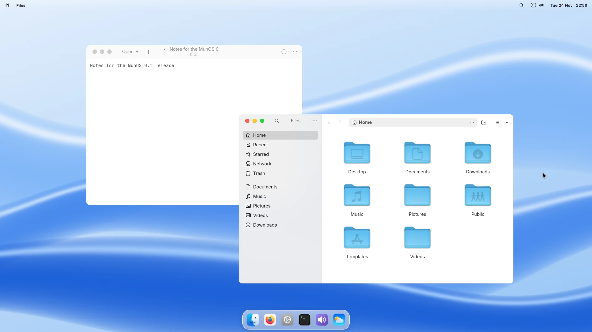
</p>

```sh
curl -fsSL https://alex-muhscience.github.io/MuhOS/install.sh | bash
```

<p align="center"><sub>Fedora 44 or 45 Workstation, x86_64. The installer checks every package before installing it with dnf, and asks first. <a href="#installation">Other ways to install</a>.</sub></p>

MuhOS is a desktop shell for the [Hyprland](https://hyprland.org/) compositor
on Fedora: the menu bar, dock, app grid, search, control centre,
notifications, equaliser, lock screen and theming of a complete desktop.
It's built on [Quickshell](https://quickshell.org/) (Qt 6 / QML) and is a
Fedora-focused fork of [Serpantinum](https://github.com/ilyamiro/serpantinum)
by Illia Miroshnichenko. It installs next to GNOME, as a session you choose
when you log in, and leaves GNOME exactly as it was.

> [!NOTE]
> **Pre-release.** MuhOS builds and passes its tests on Fedora 44 and 45, and
> full login sessions work in Fedora 44 and Fedora 45 virtual machines. It
> hasn't been validated on real hardware yet, so expect rough edges and please
> [report them](https://github.com/Alex-Muhscience/MuhOS/issues/new/choose),
> or tell us how it runs on your machine with a
> [hardware report](https://github.com/Alex-Muhscience/MuhOS/issues/new/choose).

## Contents

| Using MuhOS | Setting it up | The project |
|---|---|---|
| [Highlights](#highlights) | [Requirements](#requirements) | [How MuhOS differs from Serpantinum](#how-muhos-differs-from-serpantinum) |
| [Screenshots](#screenshots) | [Installation](#installation) | [Performance](#performance) |
| [Features](#features) | [Configuration](#configuration) | [Building and testing](#building-and-testing) |
| [Getting started](#getting-started) | [Command line](#command-line) | [Roadmap](#roadmap) |
| [Keyboard shortcuts](#keyboard-shortcuts) | [Troubleshooting](#troubleshooting) | [Contributing](#contributing) |
| [Privacy](#privacy) | [Updating and uninstalling](#updating-and-uninstalling) | [Credits](#credits) · [License](#license) |

## Highlights

<table>
  <tr>
    <td width="50%" valign="top">
      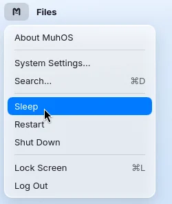
      <h3>A real menu bar</h3>
      The MuhOS logo menu for settings, sleep, restart and log out; the app
      you're using in bold, with Full Screen and Quit; search, status icons and
      the date and time on the right.
    </td>
    <td width="50%" valign="top">
      <h3>Apps that look the part</h3>
      Red and green window buttons (close, zoom), macOS-style icons (WhiteSur) and
      the Inter font, in the MuhOS session only. Windows float and open
      centred; <kbd>Super</kbd>+<kbd>T</kbd> tiles one when you want it.
    </td>
  </tr>
  <tr>
    <td valign="top">
      <h3>Glass everywhere</h3>
      The dock, control centre, search, notifications, on-screen indicator and
      lock screen are frosted glass over a live blur of what's behind them.
    </td>
    <td valign="top">
      <h3>All your apps, one click away</h3>
      The <b>Apps</b> icon in the dock shows every app in a grid, like the Apps
      view on a Mac. <kbd>Super</kbd>+<kbd>D</kbd> opens a Spotlight-style
      search for apps, files, actions and quick sums.
    </td>
  </tr>
  <tr>
    <td valign="top">
      <h3>A light equaliser</h3>
      Ten bands, presets, balance and a night mode, built on PipeWire itself:
      about 5 MiB of memory where the EasyEffects engine it replaced used
      120 MiB, and switched off while flat.
    </td>
    <td valign="top">
      <h3>Your colours, your GNOME untouched</h3>
      Light and dark, macOS presets or colours from your wallpaper, ten accent
      colours. MuhOS keeps its own app settings, so your GNOME session never
      changes.
    </td>
  </tr>
</table>

## Screenshots

<table>
  <tr>
    <td width="50%">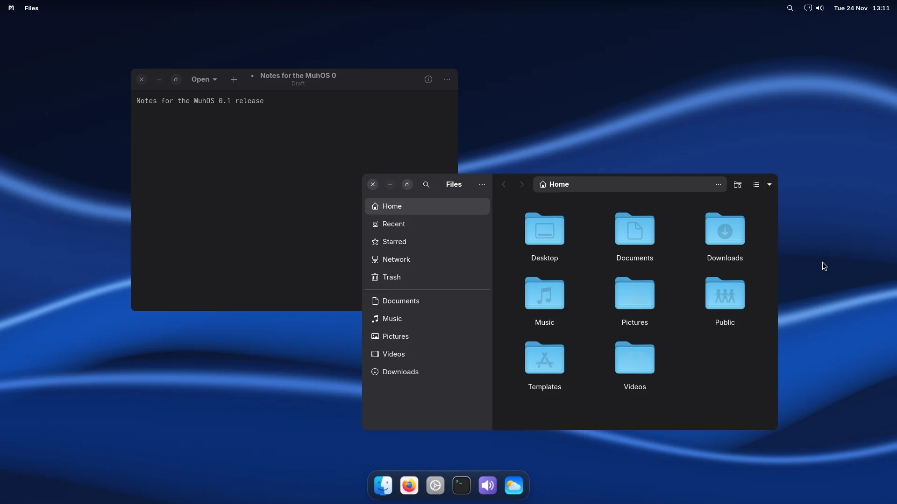</td>
    <td width="50%">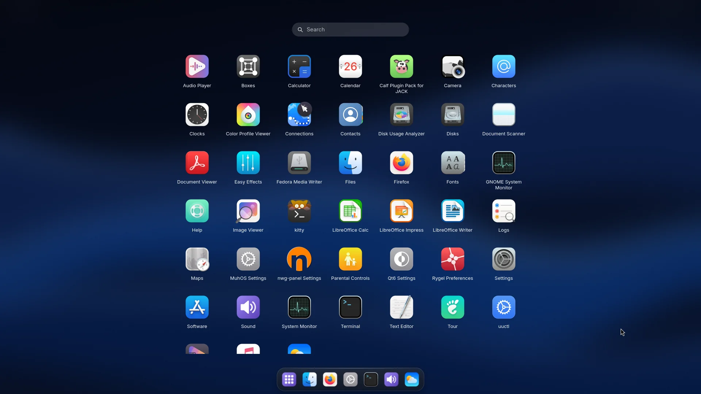</td>
  </tr>
  <tr>
    <td align="center"><b>Dark mode.</b> Apps follow it too.</td>
    <td align="center"><b>Apps.</b> Every app in a grid, from the dock; type to search.</td>
  </tr>
  <tr>
    <td>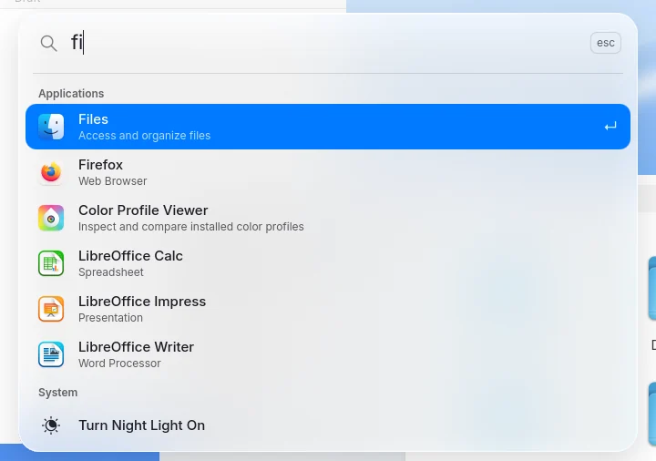</td>
    <td>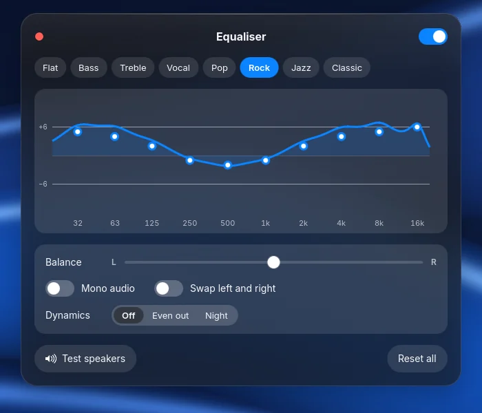</td>
  </tr>
  <tr>
    <td align="center"><b>Search.</b> Apps, files, actions and a calculator.</td>
    <td align="center"><b>Equaliser.</b> Drag the bands; the curve shows what you'll hear.</td>
  </tr>
  <tr>
    <td>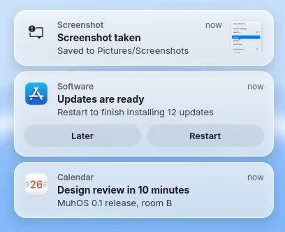</td>
    <td>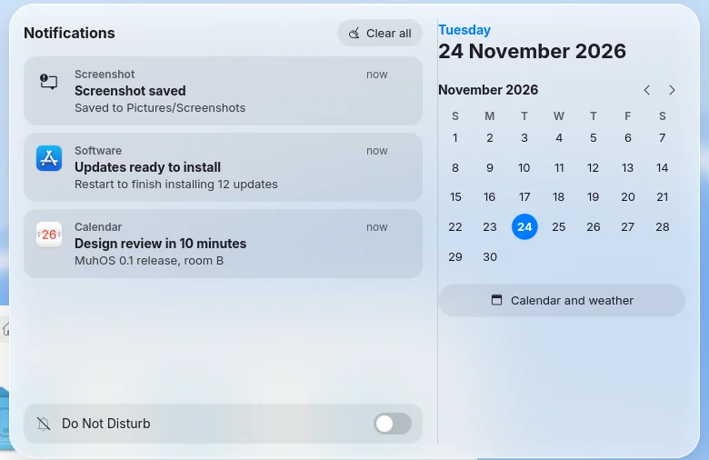</td>
  </tr>
  <tr>
    <td align="center"><b>Notifications.</b> Pictures and action buttons.</td>
    <td align="center"><b>Notification centre.</b> Click the date and time.</td>
  </tr>
  <tr>
    <td>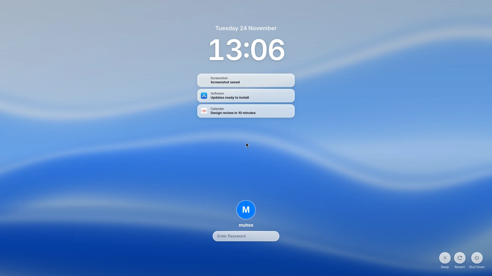</td>
    <td>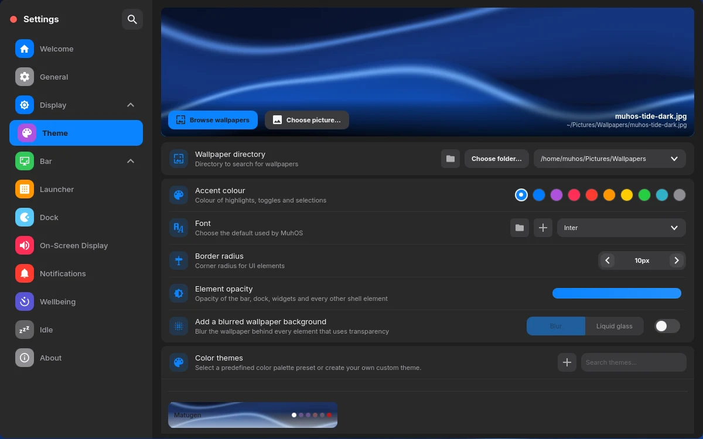</td>
  </tr>
  <tr>
    <td align="center"><b>Lock screen.</b> Notification titles only, never their contents.</td>
    <td align="center"><b>Settings.</b> Accent colours, themes, fonts, dock and more.</td>
  </tr>
  <tr>
    <td>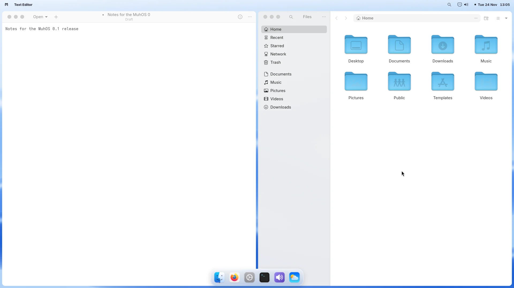</td>
    <td>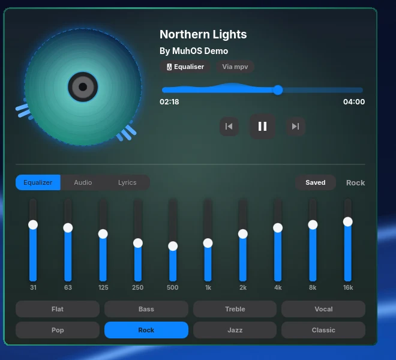</td>
  </tr>
  <tr>
    <td align="center"><b>Tiling,</b> when you want it.</td>
    <td align="center"><b>Music.</b> Cover, lyrics, equaliser and output switching.</td>
  </tr>
</table>

## Features

### The MuhOS interface

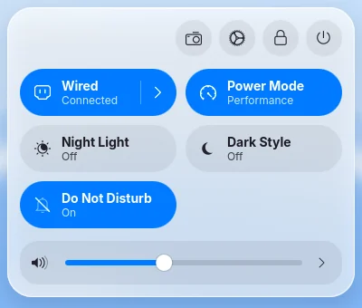

- **Menu bar.** Transparent over the wallpaper, laid out like macOS. Left:
  the MuhOS logo menu (About, System Settings, Search, Sleep, Restart, Shut
  Down, Lock Screen, Log Out), then the focused app's name in bold (Full
  Screen, Quit). Right: the tray, search, network, volume and battery, and the
  date and time. Its text turns dark over light wallpapers and light over
  dark ones, per screen.
- **Control centre.** Toggles for Wi-Fi (or Wired), Bluetooth, power mode,
  night light, dark style, do not disturb and the equaliser, with arrows into
  networks, Bluetooth devices and the equaliser; volume and brightness
  sliders (the volume arrow opens the Sound window: devices, inputs and
  per-app volume); screenshot, settings, lock and power buttons.
- **Dock.** Frosted glass, icons magnify under the pointer, open apps get a
  dot. Right-click an icon to pin or unpin it. The first icon, **Apps**,
  opens the app grid.
- **App grid.** Every installed app as a large icon over the blurred
  desktop, sorted by name, in pages as in Launchpad (swipe, scroll, the
  page dots or the arrow keys turn them), with search. The dock stays visible above it, and
  opening an app closes it.

<br clear="right">

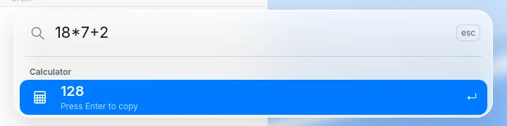

- **Search.** <kbd>Super</kbd>+<kbd>D</kbd> or the magnifier. Apps (ranked
  by match and by how often you use them), actions (settings, wallpapers,
  clipboard, screenshot, night light, dark style, do not disturb, lock; sleep,
  restart, power off and log out only after three letters), files from your
  home folders, and a calculator answer that <kbd>Enter</kbd> copies.
- **Notifications.** Glass banners at the top right with pictures and action
  buttons; they wait while you hover, swipe away to the right, and critical
  alerts stay. Do Not Disturb holds back everything but critical alerts.
- **Notification centre.** From the date and time: notifications with Clear
  all, a Do Not Disturb switch, and a month calendar.

<br clear="right">

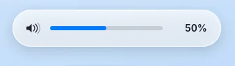

- **Equaliser.** Ten bands (32 Hz–16 kHz, ±12 dB) drawn as a live
  frequency-response curve, eight presets, balance, mono, swap, "dynamics"
  (Even out or Night) and a speaker test. It runs on PipeWire's own filters,
  only in the MuhOS session, follows whichever output you use, and switches
  off while flat. Dynamics uses `ladspa-swh-plugins`, installed by default.
- **On-screen indicator.** A glass pill for volume, microphone and
  brightness (drag or scroll it) and for caps lock, num lock and airplane
  mode.
- **Lock screen.** Your blurred wallpaper, a large clock, what's playing and
  notification titles, never their contents. It authenticates through PAM,
  so your normal password works.

<br clear="right">

- **Windows and apps.** Windows float and open centred;
  <kbd>Super</kbd>+<kbd>T</kbd> tiles one. A click focuses a window and
  brings it forward; <kbd>Super</kbd>+<kbd>Tab</kbd> or <kbd>Alt</kbd>+<kbd>Tab</kbd>
  switches; a new window opening over another is cascaded. Minimise with
  <kbd>Super</kbd>+<kbd>M</kbd> or the app menu and restore from the dock
  (apps' own title bars only have close and zoom: Hyprland ignores their
  minimise requests). Apps use the WhiteSur GTK theme and icons and the
  Inter font, in the MuhOS session only. In dark mode, apps use GNOME's own dark style, because
  WhiteSur's dark variant doesn't display GNOME 50 apps correctly yet.
- **Themes and colours.** New users start with the macOS theme and two
  original macOS-style wallpapers, light and dark. Choose another preset, or
  colours generated from your wallpaper (Matugen), and one of ten accent
  colours in Settings → Theme. Shell icons come from WhiteSur, falling back
  to Adwaita.
- **Readable everywhere.** Fixed-size windows shrink to fit small screens;
  Settings uses coloured section icons, as on a Mac.

### From Serpantinum

These come from Serpantinum and keep its design:

| | |
|---|---|
| **Music** | Player with cover, the same equaliser, synced lyrics and audio output switching. |
| **Clipboard** | History of copied text and images (cliphist), searchable. |
| **Wallpapers and themes** | Picker for images and video wallpapers; colours from the wallpaper (Matugen) or one of 96 preset themes. |
| **Screenshots** | Region or full screen, an editor, screen recording and QR-code scanning. |
| **Network and Bluetooth** | Popups for Wi-Fi networks and Bluetooth devices. |
| **Calendar and weather** | Month view and forecast. |
| **Desktop widgets** | Clock, weather, music, visualizer, battery, system usage, user, image and GitHub widgets, placed with a built-in editor. |
| **Night light** | Colour temperature with an automatic day/night schedule. |
| **Idle** | Dim, lock, screen off and suspend after set times; a keep-awake switch. |
| **Wellbeing** | Focus-time tracking. |
| **System** | Polkit authentication dialogs, interface sounds, 23 languages. |

## Getting started

1. **Install** with the command at the top, then **log out**.
2. On the login screen, click your name, then the **gear button** at the
   bottom right, choose **MuhOS (Hyprland)**, and sign in. The first start
   shows a short welcome with the most useful shortcuts.
3. Explore:
   - **Settings**: <kbd>Super</kbd>+<kbd>H</kbd>, System Settings in the logo
     menu, or "MuhOS Settings" in the dock.
   - **Apps**: the Apps icon in the dock; **search**: <kbd>Super</kbd>+<kbd>D</kbd>.
   - **Quick settings**: click the network and volume icons at the top right.
   - **Notifications and calendar**: click the date and time.
   - **Wallpaper**: <kbd>Super</kbd>+<kbd>W</kbd>; add your own pictures to
     `~/Pictures/Wallpapers`.
   - **Weather**: set a location in Settings → General → Location (it stays
     off until you do).

To go back to GNOME, log out and choose GNOME the same way. The
[user guide](https://alex-muhscience.github.io/MuhOS/docs.html) explains every
part of MuhOS in detail.

## Keyboard shortcuts

<kbd>Super</kbd> is the Windows key; in MuhOS it plays the role of
<kbd>⌘</kbd>.

| Shortcut | Action |
|---|---|
| <kbd>Super</kbd>+<kbd>D</kbd> | Search: apps, files, actions, calculator |
| <kbd>Super</kbd>+<kbd>Enter</kbd> | Terminal (Ptyxis, or whichever is installed) |
| <kbd>Super</kbd>+<kbd>E</kbd> | Files |
| <kbd>Super</kbd>+<kbd>F</kbd> | Firefox |
| <kbd>Super</kbd>+<kbd>Q</kbd> | Close the window |
| <kbd>Super</kbd>+<kbd>M</kbd> | Minimise the window (the dock brings it back) |
| <kbd>Super</kbd>+<kbd>Tab</kbd> or <kbd>Alt</kbd>+<kbd>Tab</kbd> | Next window (<kbd>Shift</kbd>: previous) |
| <kbd>Super</kbd>+<kbd>T</kbd> or <kbd>Super</kbd>+<kbd>Shift</kbd>+<kbd>F</kbd> | Tile the window, or float it again |
| <kbd>Super</kbd>+<kbd>Alt</kbd>+<kbd>F</kbd> | Maximise the window |
| <kbd>Super</kbd>+drag | Move (left button) or resize (right button) a window |
| <kbd>Super</kbd>+<kbd>←↑↓→</kbd> | Focus the window in that direction |
| <kbd>Super</kbd>+<kbd>Ctrl</kbd>+<kbd>←↑↓→</kbd> | Move the window |
| <kbd>Super</kbd>+<kbd>Shift</kbd>+<kbd>←↑↓→</kbd> | Resize the window |
| <kbd>Super</kbd>+<kbd>1</kbd>…<kbd>0</kbd> | Go to workspace 1–10 (<kbd>Shift</kbd>: move the window there) |
| Three-finger swipe | Switch workspace (touchpad) |
| <kbd>Super</kbd>+<kbd>H</kbd> | Settings |
| <kbd>Super</kbd>+<kbd>L</kbd> | Lock the screen |
| <kbd>Super</kbd>+<kbd>C</kbd> | Clipboard history |
| <kbd>Super</kbd>+<kbd>W</kbd> | Wallpapers |
| <kbd>Super</kbd>+<kbd>Shift</kbd>+<kbd>M</kbd> | Music |
| <kbd>Super</kbd>+<kbd>V</kbd> | Sound |
| <kbd>Super</kbd>+<kbd>N</kbd> | Network |
| <kbd>Super</kbd>+<kbd>S</kbd> | Calendar |
| <kbd>Super</kbd>+<kbd>B</kbd> | System panel |
| <kbd>Super</kbd>+<kbd>Space</kbd> | Play or pause |
| <kbd>Super</kbd>+<kbd>R</kbd> | Reload the shell |
| <kbd>Super</kbd>+<kbd>A</kbd> | Auto-hide the bar on or off |
| <kbd>Print</kbd> | Screenshot of an area (<kbd>Shift</kbd>: open it in the editor) |
| <kbd>Super</kbd>+<kbd>Print</kbd> | Screenshot of the whole screen (<kbd>Shift</kbd>: editor) |
| Media, volume and brightness keys | Work as labelled, also on the lock screen |

Change or add shortcuts in `~/.config/muhos/hypr/user.lua` (see
[Configuration](#configuration)).

## Privacy

- No telemetry and no background update checks. Only when you open
  Settings does MuhOS ask GitHub for its newest release, to offer an
  update; nothing about you is sent.
- Your location isn't looked up automatically. The weather stays off until
  you set a location; forecasts then come from [Open-Meteo](https://open-meteo.com/).
  The Detect button does a one-time lookup through ipapi.co, and
  `general.ipGeolocation` turns automatic lookup on if you want it.
- Lyrics, when you use them, come from the public services Serpantinum uses.
- The lock screen shows notification titles, never their contents.

## Requirements

| | |
|---|---|
| Distribution | Fedora 44 or 45 Workstation, x86_64 |
| Compositor | Hyprland 0.56 or newer (tested with 0.57.2), from the [`lionheartp/Hyprland`](https://copr.fedorainfracloud.org/coprs/lionheartp/Hyprland/) COPR |
| Shell toolkit | Quickshell 0.3.2 and Matugen 4.2, packaged by MuhOS (Fedora 44 and 45 ship older versions) |
| App theme | WhiteSur GTK theme and icons, packaged by MuhOS; Inter from Fedora |
| Login manager | GDM (kept; MuhOS adds a session to it) |
| Graphics | Any GPU Hyprland supports; a real GPU makes the glass blur cheaper |

Other compositors supported upstream (Niri, Sway, Mango) are still in the
tree but untested in MuhOS.

## Installation

MuhOS isn't in a package repository yet. Each
[release](https://github.com/Alex-Muhscience/MuhOS/releases) has ready-made
RPMs for Fedora 44 and Fedora 45 (x86_64), source RPMs, and a `SHA256SUMS`
file.

### One command

```sh
curl -fsSL https://alex-muhscience.github.io/MuhOS/install.sh | bash
```

[`site/install.sh`](site/install.sh) checks that you're on Fedora 44 or 45
(x86_64), downloads the newest release's packages for your version from
GitHub, verifies each one against the release's `SHA256SUMS` and stops if any
doesn't match, enables the Hyprland COPR, and installs with dnf after asking.
Everything runs from a function called on its last line, so a download cut
off halfway runs nothing.

| Option (add <code>&#124; bash -s -- …</code>) | Effect |
|---|---|
| `--dry-run` | Download and verify only |
| `--keep DIR` | Keep the downloaded packages in `DIR` |
| `--tag v0.1.0-pre.5` | Install a specific release |
| `--yes` | Don't ask (dnf runs with `-y`) |

To read it first: `curl -fsSLO https://alex-muhscience.github.io/MuhOS/install.sh`,
look through it, then `bash install.sh`.

<details>
<summary><b>Install by hand from a release</b></summary>

Download the `.noarch.rpm` and `.x86_64.rpm` files for your Fedora version
(`fc44` or `fc45` in the name) and `SHA256SUMS` from the
[latest release](https://github.com/Alex-Muhscience/MuhOS/releases), then:

```sh
sha256sum --check --ignore-missing SHA256SUMS     # every file should say OK
sudo dnf copr enable lionheartp/Hyprland           # Hyprland
sudo dnf install ./muhos-*.noarch.rpm ./quickshell-*.x86_64.rpm ./matugen-*.x86_64.rpm ./whitesur-*.noarch.rpm
```

The packages aren't signed yet, so dnf notes that it skipped signature
checks; the checksums are how you verify them for now.

</details>

<details>
<summary><b>Build it yourself</b></summary>

Building happens as your user; only the final install needs `sudo`.

1. Enable Hyprland and install the build tools:

   ```sh
   sudo dnf copr enable lionheartp/Hyprland
   sudo dnf install rpm-build dnf-plugins-core git
   ```

2. Build Quickshell, Matugen and WhiteSur from the source RPMs on the
   [release page](https://github.com/Alex-Muhscience/MuhOS/releases)
   (everything they need is included, so they build offline):

   ```sh
   sudo dnf builddep ./quickshell-*.src.rpm ./matugen-*.src.rpm ./whitesur-*.src.rpm
   rpmbuild --rebuild ./quickshell-*.src.rpm ./matugen-*.src.rpm ./whitesur-*.src.rpm
   ```

3. Build MuhOS from this repository:

   ```sh
   git clone https://github.com/Alex-Muhscience/MuhOS.git
   cd MuhOS
   sudo dnf builddep packaging/fedora/muhos.spec
   packaging/fedora/build-rpm out
   ```

4. Install everything:

   ```sh
   sudo dnf install ~/rpmbuild/RPMS/x86_64/{quickshell,matugen}-*.rpm ~/rpmbuild/RPMS/noarch/whitesur-*.rpm out/muhos-*.noarch.rpm
   ```

</details>

Then log out, choose **MuhOS (Hyprland)** with the gear button on the login
screen, and sign in.
[packaging/fedora/README.fedora.md](packaging/fedora/README.fedora.md) lists
exactly what the package installs and what it creates in your home folder.

## Configuration

Most things are in the Settings app. Under the hood:

| File | Holds |
|---|---|
| `~/.config/serpantinum/settings.json` | Shell settings (written by the Settings app) |
| `~/.config/muhos/hypr/hyprland.lua` | Loads the packaged Hyprland defaults, then your `user.lua`; created once, never overwritten |
| `~/.config/muhos/hypr/user.lua` | Your own Hyprland settings and shortcuts (create it) |
| `~/.config/dconf/muhos` | App settings (theme, icons, font, window buttons) for the MuhOS session only |
| `~/.local/state/serpantinum/` | Generated colours, the equaliser and other state |
| `/usr/share/muhos/hypr/` | The packaged Hyprland defaults (read-only; copy what you want to change into `user.lua`) |

**Your own Hyprland settings** go in `user.lua`. It runs after the defaults,
so it wins, and updates never overwrite it:

```lua
-- ~/.config/muhos/hypr/user.lua
hl.bind("SUPER + X", hl.dsp.exec_cmd("ptyxis"))      -- a second terminal
hl.monitor({ output = "DP-1", mode = "2560x1440@144", position = "0x0", scale = 1.0 })
```

Check it with `Hyprland --verify-config -c ~/.config/muhos/hypr/hyprland.lua`.

**MuhOS settings** in `settings.json`:

| Setting | Effect |
|---|---|
| `"bar": { "layout": "hybrid" }` | The GNOME-style bar: workspace dots on the left, and a clock island in the middle that shows the cover while music plays and expands into a player (default `"macos"`) |
| `"bar": { "design": "classic" }` | Serpantinum's original design everywhere: its bar, dock style, launcher, notifications, indicator and lock screen |
| `"bar": { "position": "left" }` or `"autohide": true` | Side and auto-hiding bars use Serpantinum's bar for now (the rest stays MuhOS) |
| `"theme": { "accent": "#FF9500" }` | Any accent colour, over any theme; `""` keeps the theme's own |
| `"dock": { "hoverScale": 160, "cascadeScale": true }` | Dock magnification (percent) and whether neighbours grow too; also in Settings → Dock |
| `"muhos": { "solidPanels": true }` | Solid panels instead of glass, like "Reduce transparency" on a Mac |
| `"general": { "ipGeolocation": true }` | Find your location from your IP address for the weather (off by default) |

## Command line

`muhos` controls the running shell:

```sh
muhos msg toggle launcher                 # a popup: launcher, music, calendar, network,
                                          #   volume, system, wallpaper, guide, clipboard
muhos msg workspace 3                     # switch workspace (add "move" to move the window)
muhos ipc call muhos controlCentre        # open or close the control centre
muhos ipc call muhos notificationCentre   # the notification centre
muhos ipc call muhos appGrid              # the app grid
muhos ipc call muhos equalizer            # the equaliser
muhos screenshot --full --edit            # also: --record, --scan-qr
muhos lock                                # lock the screen
muhos reload                              # reload the shell
muhos --help                              # everything else
```

The equaliser can also be scripted:
`/usr/share/muhos/src/quickshell/media/equalizer.sh preset Rock`
(also `enable true|false`, `set_band_live N GAIN`, `set_balance`, `set_mono`,
`set_swap`, `set_dynamics off|balanced|night`, `get`).

Inside the shell, MuhOS keeps Serpantinum's internal command names
(`serpantinum`, `serpantinumd`) so upstream scripts keep working; they live in
`/usr/libexec/muhos/` and aren't on your `PATH`.

## Troubleshooting

```sh
journalctl --user -u muhos-shell -b             # shell logs
systemctl --user status muhos-session.target    # is the session running?
Hyprland --verify-config -c ~/.config/muhos/hypr/hyprland.lua
muhos reload                                     # restart the shell's interface
```

<details>
<summary><b>"MuhOS (Hyprland)" is missing on the login screen</b></summary>

Check that Hyprland installed; it comes from the COPR the installer enables:
`rpm -q hyprland muhos`.

</details>

<details>
<summary><b>Apps look like GNOME in dark mode</b></summary>

Expected for now: in dark mode apps use GNOME's own dark style, because
WhiteSur's dark variant doesn't display GNOME 50 apps correctly. If you
switch Dark Style while apps use WhiteSur, they change at your next login.

</details>

<details>
<summary><b>The equaliser does nothing</b></summary>

Check that its toggle in the control centre is on and that it isn't set to
Flat (a flat equaliser switches itself off), then
`systemctl --user status serpantinum-eq`. Dynamics needs
`sudo dnf install ladspa-swh-plugins`.

</details>

<details>
<summary><b>The bar looks like Serpantinum's</b></summary>

The MuhOS bar is replaced by the classic one when the bar is on a side,
auto-hides, or `bar.design` is `"classic"`.

</details>

<details>
<summary><b>The dock has tiles or doesn't magnify</b></summary>

MuhOS's dock settings are defaults for new users. If you changed dock
settings before, turn on floating, magnification and cascade in
Settings → Dock.

</details>

<details>
<summary><b>Firefox doesn't look like the other apps</b></summary>

Firefox draws its own interface, so GTK themes don't style it.

</details>

## Updating and uninstalling

**Update** by running the install command again: it installs the newest
release over the old one and keeps your settings. When Settings shows an
update, its Update button runs that command for you in a terminal.

**Uninstall**:

```sh
sudo dnf remove muhos whitesur-gtk-theme whitesur-icon-theme
rm -r ~/.config/dconf/muhos                              # optional: MuhOS app settings
rm -r ~/.config/muhos                                    # optional: your MuhOS Hyprland config
rm -r ~/.config/serpantinum ~/.local/state/serpantinum   # optional: shell settings and state
```

MuhOS never changes your GNOME setup or other configuration, so nothing else
needs restoring.

## How MuhOS differs from Serpantinum

- **Installed as Fedora packages.** RPMs installed with dnf; the one-line
  installer only downloads, verifies and installs those packages. No
  telemetry, no network update check; updates come through dnf.
- **Doesn't take over your system.** GDM stays your login manager, no
  services are enabled permanently, nothing is written to `/usr/local`, and
  your `~/.config/hypr`, kitty, cava and fastfetch configuration is never
  touched. App themes and settings live in a MuhOS-only profile, cleared when
  you log out.
- **A session you choose at login.** The shell runs as a systemd user
  service tied to the session and restarts if it crashes.
- **Configuration that survives updates.** Your Hyprland configuration lives
  in `~/.config/muhos/hypr/`: a small `hyprland.lua` that loads the packaged
  defaults, plus your `user.lua`.
- **Its own interface.** The menu bar, control centre, app grid, search,
  notifications, equaliser window, on-screen indicator and lock screen are
  MuhOS's own, the dock is restyled, and the equaliser runs on PipeWire
  instead of EasyEffects.
- **Every bundled asset is cleared for redistribution.** Fonts, sounds and
  images each have a recorded source and licence ([ASSETS.md](ASSETS.md));
  anything without one was removed or replaced with openly licensed or
  original work.

The full list of changes is in
[CHANGES-FROM-UPSTREAM.md](CHANGES-FROM-UPSTREAM.md).

## Performance

Every claim here comes from a reproducible benchmark in a Fedora 44 VM
([tests/vm/](tests/vm/README.md), software rendering, no GPU; median of
several runs). Reports are in [bench/results/](bench/results/).

| Change | Measured effect |
|---|---|
| New welcome screen (0.1.0-0.5) | Shell CPU while the first-run screen shows: 130% → 0.5% of a core |
| New menu bar (0.1.0-0.10) | Idle shell CPU 0.52% → 0.07%; shell memory 503 → 473 MiB |
| Glass design (0.1.0-0.12) | No measurable change: shell 0.07%, 473 MiB; Hyprland 203 MiB |
| Equaliser on PipeWire (0.1.0-0.15) | Engine 4.9 MiB and 1.3% of a core, where EasyEffects used 119.8 MiB and 2.25% ([report](bench/results/2026-11-24-vm-eq-easyeffects-vs-filterchain.md)) |

Known issue: Hyprland's own memory grew from 175 MiB (0.1.0-0.1) to 203 MiB
(0.1.0-0.11); the cause is still being looked for. Not measured yet: the blur's
cost on a real GPU while windows move under the glass, and the macOS look
added in 0.1.0-0.14.

## Building and testing

Builds and checks run in Fedora containers, so your system stays untouched:

```sh
podman run --rm -v "$PWD":/src:Z -w /src registry.fedoraproject.org/fedora:45 bash -c '
  dnf -y install git python3 rpm-build systemd systemd-rpm-macros desktop-file-utils jq xdg-user-dirs adwaita-icon-theme &&
  git config --global --add safe.directory /src &&
  packaging/fedora/build-rpm out &&
  tests/fedora/test-package.sh out/muhos-*.noarch.rpm'

python3 -I tools/asset-inventory --strict   # every asset licensed and cleared
python3 -I tools/lint-baseline --check      # shellcheck/qmllint findings must not grow
```

CI builds and tests the package on Fedora 44 and 45 and runs the asset and
lint checks on every push. `tests/vm/` builds Fedora virtual machines with
MuhOS installed, checks the login session and runs the benchmarks
([tests/vm/README.md](tests/vm/README.md)).

<details>
<summary><b>Repository layout</b></summary>

| Path | Contents |
|---|---|
| `src/quickshell/` | The shell (QML) |
| `src/quickshell/muhos/` | MuhOS's own interface: menu bar, control centre, app grid, search, notifications, equaliser, indicator, lock screen, glass and design tokens |
| `src/quickshell/media/` | Music window and the equaliser engine (`eq_engine.py`) |
| `src/scripts/`, `bin/` | Helper scripts and the command-line tools |
| `src/assets/` | Fonts, sounds, shaders, themes, translations, wallpapers |
| `compositors/` | Default compositor configuration (Hyprland is the one MuhOS uses) |
| `packaging/fedora/` | RPM specs (MuhOS, Quickshell, Matugen, WhiteSur), session, units, Hyprland defaults, dconf profile |
| `site/` | The website and the installer |
| `tools/` | Asset inventory, lint baseline, upstream sync, image generation |
| `tests/fedora/` | Package install tests |
| `tests/vm/` | VM images, session checks, benchmarks |
| `bench/results/` | Benchmark reports |
| `docs/` | README images |

</details>

## Roadmap

- [x] RPM packaging, GDM session, systemd integration
- [x] Assets cleared for redistribution; MuhOS branding
- [x] VM test harness and reproducible benchmarks
- [x] Glass design: menu bar, control centre, dock, search, notifications, indicator, lock screen
- [x] macOS look: logo menu, floating windows, WhiteSur apps and icons, accent colours
- [x] Equaliser on PipeWire, app grid, one-command installer, website
- [x] Fedora 45
- [ ] Validate on real hardware (Intel, AMD, NVIDIA, hybrid graphics)
- [ ] Music, network, wallpaper and settings windows in the glass style
- [ ] Find and fix Hyprland's memory growth
- [ ] Sign the packages and publish them in a COPR repository

## Contributing

Bug reports, hardware reports and pull requests are all welcome. Start with
[CONTRIBUTING.md](CONTRIBUTING.md) or the
[website's contribute page](https://alex-muhscience.github.io/MuhOS/contribute.html);
questions and ideas go to [Discussions](https://github.com/Alex-Muhscience/MuhOS/discussions).

MuhOS tracks upstream Serpantinum releases and keeps its changes small and
labelled, so fixes can flow back upstream: every commit starts with
`[general]` (useful upstream), `[fedora]`, `[brand]`, `[fork]`, `[ci]` or
`[bench]`. [FORK.md](FORK.md) explains the labels, how upstream releases are
merged, and the rule for evidence: no performance claim without a benchmark.

## Credits

- [Serpantinum](https://github.com/ilyamiro/serpantinum) by Illia Miroshnichenko
  and its [contributors](https://github.com/ilyamiro/serpantinum/graphs/contributors):
  the shell MuhOS is built on.
- [Quickshell](https://quickshell.org/), the toolkit the shell runs on;
  [Hyprland](https://hyprland.org/), the compositor; and
  [PipeWire](https://pipewire.org/), which runs the equaliser.
- [Matugen](https://github.com/InioX/matugen) for wallpaper colours.
- [WhiteSur](https://github.com/vinceliuice/WhiteSur-gtk-theme) GTK theme
  (MIT) and [icon theme](https://github.com/vinceliuice/WhiteSur-icon-theme)
  (GPL-3.0) by Vince Liuice, packaged by MuhOS without the Apple logo icons;
  the [Adwaita icon theme](https://gitlab.gnome.org/GNOME/adwaita-icon-theme)
  by the GNOME project; and the [Inter](https://rsms.me/inter/) font by
  Rasmus Andersson.
- The [SWH LADSPA plugins](https://github.com/swh/ladspa) by Steve Harris
  for the equaliser's dynamics.
- Sounds by [Kenney](https://kenney.nl) (CC0) and Romain Raynal's
  [Open Sounds](https://romainraynal.gumroad.com/) (CC0).
- Fonts from [Nerd Fonts](https://www.nerdfonts.com/) and the font projects
  listed in [ASSETS.md](ASSETS.md).

The design takes cues from GNOME and macOS; MuhOS isn't affiliated with Apple,
the GNOME Foundation or the Fedora Project. Screenshots show third-party apps
and icons (such as Firefox, a Mozilla trademark) as they appear on the
desktop.

## License

Copyright (C) 2026 Illia Miroshnichenko (Serpantinum) and MuhOS contributors.

MuhOS is licensed under the GNU Affero General Public License version 3, or
(at your option) any later version; see [LICENSE.md](LICENSE.md) and
[NOTICE](NOTICE). Bundled fonts, sounds and images have their own licences,
listed in [ASSETS.md](ASSETS.md).
