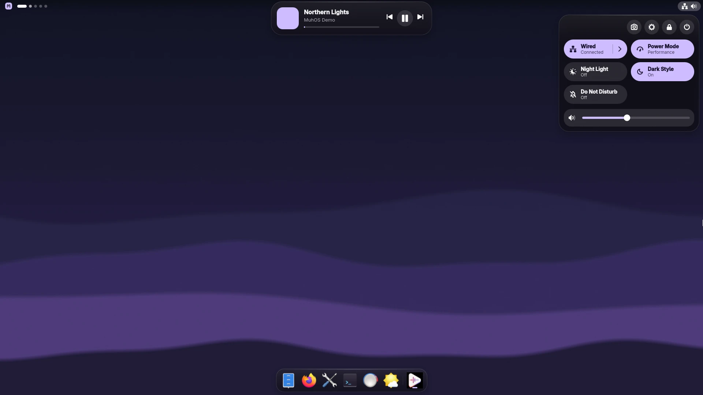
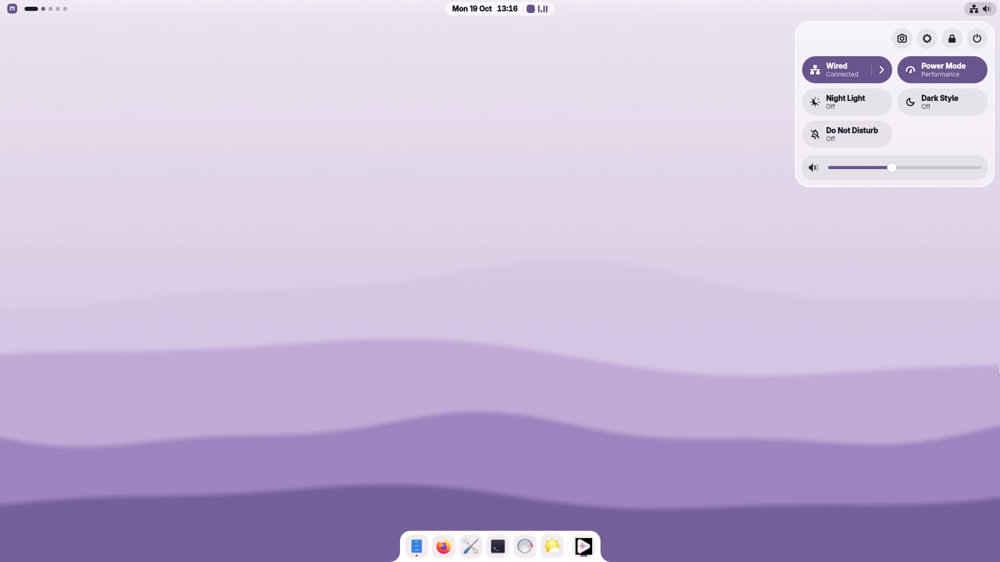
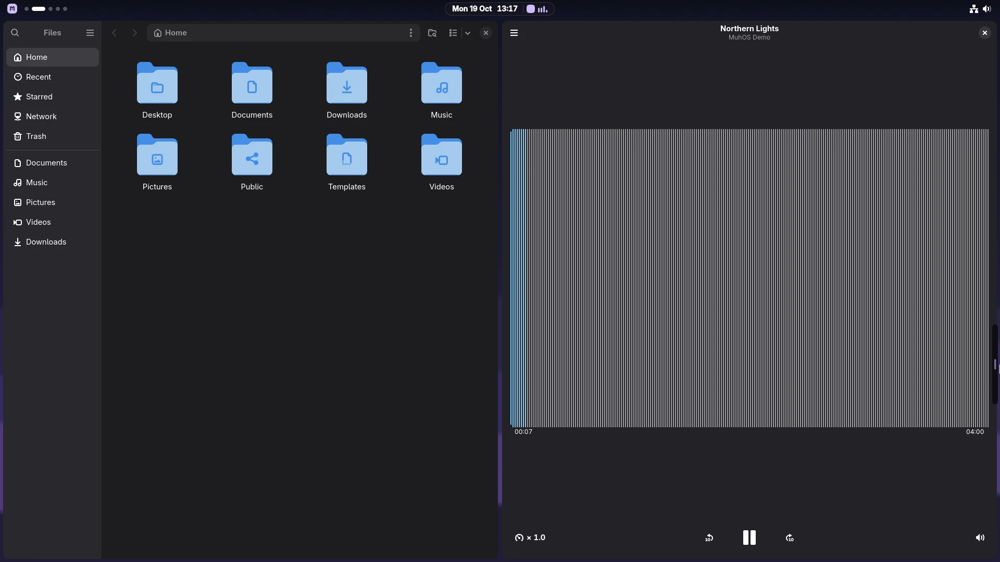
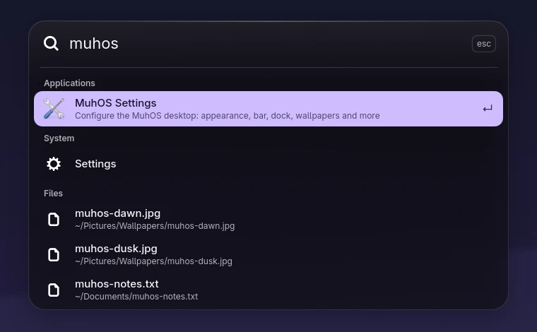
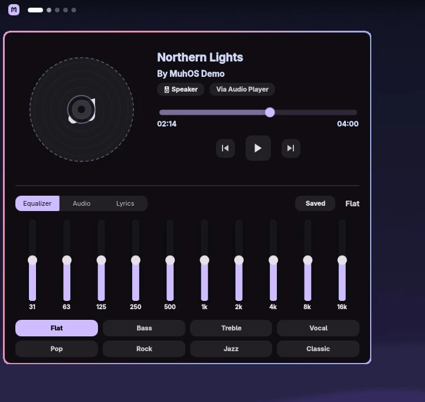
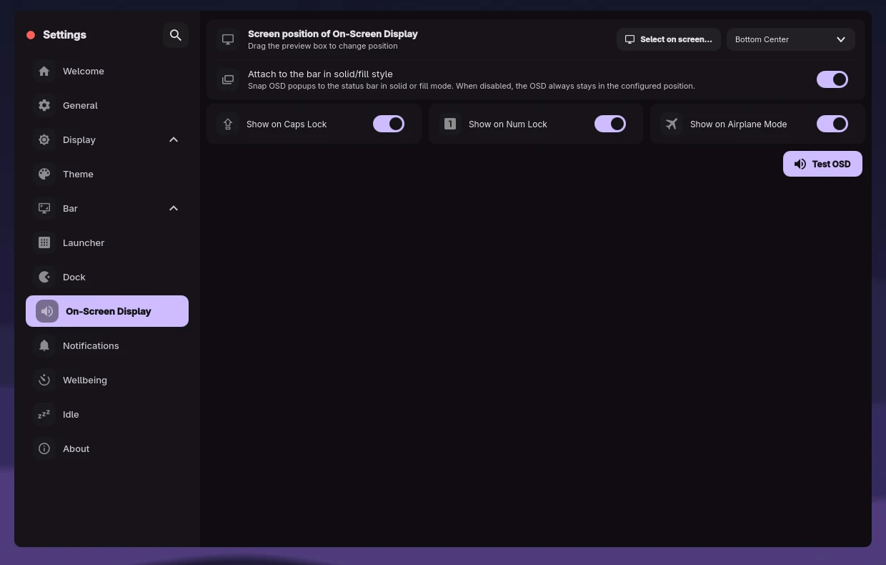
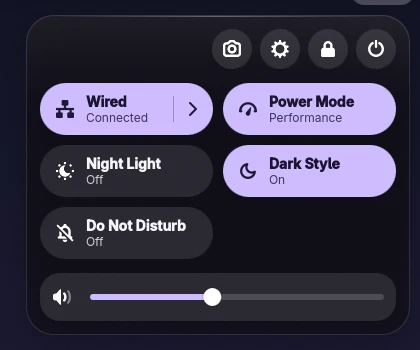
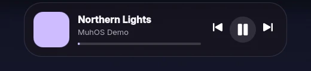

<p align="center">
  
</p>

<h1 align="center">MuhOS</h1>

<p align="center">
  <b>A calm, modern desktop for Hyprland on Fedora.</b><br>
  GNOME's layout, macOS-style glass, colours from your wallpaper.
</p>

<p align="center">
  <a href="https://github.com/Alex-Muhscience/MuhOS/actions/workflows/ci.yml"></a>
  <a href="LICENSE.md"></a>
  
  
  
  
</p>

<p align="center">
  
</p>

MuhOS is a desktop shell for the [Hyprland](https://hyprland.org/) compositor
on Fedora: the menu bar, control centre, launcher, dock, notifications, lock
screen, desktop widgets and theming of a complete desktop. It is built on
[Quickshell](https://quickshell.org/) (Qt 6 / QML) and is a Fedora-focused
fork of [Serpantinum](https://github.com/ilyamiro/serpantinum) by Illia
Miroshnichenko.

> [!NOTE]
> **Pre-release.** The package builds, passes its install tests, and a full
> GDM login session works in Fedora 44 virtual machines. It has not been
> validated on real hardware yet. The redesign is in progress: the menu bar
> and control centre are new; the dock, launcher, notifications and lock
> screen still use Serpantinum's design. Expect rough edges, and please
> [report them](https://github.com/Alex-Muhscience/MuhOS/issues).

## Contents

- [Screenshots](#screenshots)
- [Features](#features)
- [How MuhOS differs from Serpantinum](#how-muhos-differs-from-serpantinum)
- [Requirements](#requirements)
- [Installation](#installation)
- [First steps](#first-steps)
- [Keyboard shortcuts](#keyboard-shortcuts)
- [Configuration](#configuration)
- [Command line](#command-line)
- [Privacy](#privacy)
- [Performance](#performance)
- [Troubleshooting](#troubleshooting)
- [Uninstalling](#uninstalling)
- [Building and testing](#building-and-testing)
- [Roadmap](#roadmap)
- [Contributing](#contributing)
- [Credits](#credits)
- [License](#license)

## Screenshots

<table>
  <tr>
    <td width="50%"></td>
    <td width="50%"></td>
  </tr>
  <tr>
    <td align="center"><b>Light mode.</b> Bar text adapts to the wallpaper; the accent comes from it too.</td>
    <td align="center"><b>Tiling.</b> Hyprland arranges windows; the menu bar stays out of the way.</td>
  </tr>
  <tr>
    <td></td>
    <td></td>
  </tr>
  <tr>
    <td align="center"><b>Launcher.</b> Apps, files, emoji, and commands with <code>&gt;</code>.</td>
    <td align="center"><b>Music.</b> Equalizer with presets, lyrics, output switching.</td>
  </tr>
  <tr>
    <td colspan="2"></td>
  </tr>
  <tr>
    <td colspan="2" align="center"><b>Settings.</b> Display, theme, bar, dock, launcher, notifications, idle and more, all in one app.</td>
  </tr>
</table>

## Features

### The MuhOS interface (new)



- **Menu bar.** Transparent over the wallpaper and laid out like GNOME: the
  apps button and workspace dots on the left (the current workspace is a
  pill, workspaces with windows are brighter), the clock in the middle,
  network, volume and battery on the right. Its text turns dark over light
  wallpapers and light over dark ones, per screen. Scroll on the dots to
  switch workspace, on the status icons to change the volume.
- **Clock island.** While music plays, the clock shows the cover and a small
  live visualizer; click it to expand it into a player with progress and
  controls. Without music, it opens the calendar.
- **Control centre.** GNOME's system menu in glass: toggles for Wi-Fi (or
  Wired), Bluetooth, power mode, night light, dark style and do not disturb,
  with arrows into the network and Bluetooth panels; volume and brightness
  sliders (brightness only where a backlight or DDC display exists);
  screenshot, settings and lock buttons; and a power menu with suspend,
  restart, power off and log out. Escape or a click outside closes it.
- **Adwaita icons and wallpaper colours.** Symbols come from GNOME's Adwaita
  icon theme, apps show their own icons, and the accent colour is generated
  from your wallpaper. Light and dark modes are both supported.



<br clear="right">

### From Serpantinum

These come from Serpantinum and keep its design for now; MuhOS is
redesigning them next.

| | |
|---|---|
| **Launcher** | Applications, files and emoji, with frequently used items first; type `>` for commands. |
| **Music** | Player popup with cover, ten-band equalizer and presets, synced lyrics, audio output switching. |
| **Dock** | Pinned and running apps, with app menus. |
| **Notifications** | Popups and a notification centre, with do not disturb. |
| **Clipboard** | History of copied text and images (cliphist), searchable. |
| **Wallpapers and themes** | Picker for images and video wallpapers; colours generated from the wallpaper (Matugen) or one of 96 preset themes. |
| **Screenshots** | Region or full screen, an editor, screen recording and QR-code scanning. |
| **Network, Bluetooth, volume** | Popups for Wi-Fi networks, Bluetooth devices, and per-app volume. |
| **Calendar and weather** | Month view and forecast. |
| **On-screen display** | Volume, brightness, caps lock, num lock and airplane mode indicators. |
| **Desktop widgets** | Clock, weather, music, visualizer, battery, system usage, user, image and GitHub widgets, placed with a built-in editor. |
| **Lock screen** | Authenticates through PAM (`system-auth`), so it works with your normal password. |
| **Night light** | Colour temperature with an automatic day/night schedule. |
| **Idle** | Dim, lock and suspend after configurable times; a keep-awake switch. |
| **Wellbeing** | Focus-time tracking. |
| **System** | Polkit authentication dialogs, UI sounds, 23 interface languages. |

## How MuhOS differs from Serpantinum

- **Installed as an RPM**, not by a `curl | bash` script. There is no
  telemetry and no network update check; updates come from the package.
- **Does not take over your system.** GDM stays your login manager, no
  services are enabled permanently, nothing is written to `/usr/local`, and
  your existing `~/.config/hypr`, kitty, cava and fastfetch configuration is
  never touched.
- **A session you choose at login.** Pick "MuhOS (Hyprland)" on the GDM login
  screen. The shell runs as a systemd user service tied to the session and is
  restarted if it crashes.
- **Configuration that survives updates.** Your Hyprland configuration lives
  in `~/.config/muhos/hypr/`: a small `hyprland.lua` that loads the packaged
  defaults, plus your own `user.lua`. Package updates improve the defaults
  without overwriting your changes.
- **Its own interface.** The menu bar and control centre are rebuilt (see
  [Features](#features)), and they open popups directly instead of starting a
  helper script and a second Quickshell process for every click.
- **Every bundled asset is cleared for redistribution.** Fonts, sounds and
  images each have a recorded source and license ([ASSETS.md](ASSETS.md));
  material without one was removed or replaced with openly licensed or
  original work.

The full list of changes is in
[CHANGES-FROM-UPSTREAM.md](CHANGES-FROM-UPSTREAM.md).

## Requirements

| | |
|---|---|
| Distribution | Fedora 44 Workstation, x86_64 |
| Compositor | Hyprland 0.56, from the [`lionheartp/Hyprland`](https://copr.fedorainfracloud.org/coprs/lionheartp/Hyprland/) COPR |
| Shell toolkit | Quickshell 0.3.2 and Matugen 4.2, packaged by MuhOS (Fedora 44 ships older versions) |
| Login manager | GDM (kept; MuhOS adds a session entry) |
| Graphics | Any GPU Hyprland supports; a GPU makes the glass blur cheaper |

Other compositors supported upstream (Niri, Sway, Mango) are still in the
tree but untested in MuhOS.

## Installation

MuhOS is not in a package repository yet, so for now you build three RPMs.
Building happens as your user; only the final install needs `sudo`.

**1. Enable Hyprland and install the build tools**

```sh
sudo dnf copr enable lionheartp/Hyprland
sudo dnf install rpm-build dnf-plugins-core git
```

**2. Build Quickshell and Matugen** from the source RPMs on the
[release page](https://github.com/Alex-Muhscience/MuhOS/releases)
(`quickshell-*.src.rpm` and `matugen-*.src.rpm`; Matugen's Rust crates are
included, so it builds offline):

```sh
sudo dnf builddep ./quickshell-*.src.rpm ./matugen-*.src.rpm
rpmbuild --rebuild ./quickshell-*.src.rpm ./matugen-*.src.rpm
```

**3. Build MuhOS** from this repository:

```sh
git clone https://github.com/Alex-Muhscience/MuhOS.git
cd MuhOS
sudo dnf builddep packaging/fedora/muhos.spec
packaging/fedora/build-rpm out
```

**4. Install everything**

```sh
sudo dnf install ~/rpmbuild/RPMS/x86_64/{quickshell,matugen}-*.rpm out/muhos-*.noarch.rpm
```

This pulls in Hyprland and the other dependencies. Then log out, click the
gear on the GDM login screen, choose **MuhOS (Hyprland)** and sign in.

[packaging/fedora/README.fedora.md](packaging/fedora/README.fedora.md)
lists exactly what the package installs and what it creates in your home
folder.

## First steps

- **Welcome screen.** The first login shows a short welcome with the most
  useful shortcuts; it appears once.
- **Settings.** Press <kbd>Super</kbd>+<kbd>H</kbd>, right-click the logo in
  the menu bar, or open "MuhOS Settings" from the dock or launcher.
- **Wallpaper.** Press <kbd>Super</kbd>+<kbd>W</kbd>. Put your own images or
  videos in `~/Pictures/Wallpapers`; the colours follow the wallpaper you
  pick.
- **Weather.** Stays off until you set a location in Settings → General →
  Location (see [Privacy](#privacy)).
- **Apps.** Press <kbd>Super</kbd>+<kbd>D</kbd> or click the logo.

## Keyboard shortcuts

<kbd>Super</kbd> is the Windows key.

| Shortcut | Action |
|---|---|
| <kbd>Super</kbd>+<kbd>D</kbd> | App launcher |
| <kbd>Super</kbd>+<kbd>Enter</kbd> | Terminal (kitty) |
| <kbd>Super</kbd>+<kbd>E</kbd> | Files |
| <kbd>Super</kbd>+<kbd>F</kbd> | Firefox |
| <kbd>Super</kbd>+<kbd>Q</kbd> | Close window |
| <kbd>Super</kbd>+<kbd>Alt</kbd>+<kbd>F</kbd> | Maximize window |
| <kbd>Super</kbd>+<kbd>Shift</kbd>+<kbd>F</kbd> | Float or tile window |
| <kbd>Super</kbd>+<kbd>←↑↓→</kbd> | Focus window in that direction |
| <kbd>Super</kbd>+<kbd>Ctrl</kbd>+<kbd>←↑↓→</kbd> | Move window |
| <kbd>Super</kbd>+<kbd>Shift</kbd>+<kbd>←↑↓→</kbd> | Resize window |
| <kbd>Super</kbd>+drag | Move (left button) or resize (right button) a window |
| <kbd>Super</kbd>+<kbd>1</kbd>…<kbd>0</kbd> | Go to workspace 1–10 |
| <kbd>Super</kbd>+<kbd>Shift</kbd>+<kbd>1</kbd>…<kbd>0</kbd> | Move window to workspace 1–10 |
| Three-finger swipe | Switch workspace (touchpad) |
| <kbd>Super</kbd>+<kbd>C</kbd> | Clipboard history |
| <kbd>Super</kbd>+<kbd>M</kbd> | Music |
| <kbd>Super</kbd>+<kbd>S</kbd> | Calendar |
| <kbd>Super</kbd>+<kbd>N</kbd> | Network |
| <kbd>Super</kbd>+<kbd>V</kbd> | Volume |
| <kbd>Super</kbd>+<kbd>B</kbd> | System panel |
| <kbd>Super</kbd>+<kbd>W</kbd> | Wallpapers |
| <kbd>Super</kbd>+<kbd>H</kbd> | Settings |
| <kbd>Super</kbd>+<kbd>L</kbd> | Lock screen |
| <kbd>Super</kbd>+<kbd>Space</kbd> | Play or pause media |
| <kbd>Super</kbd>+<kbd>R</kbd> | Reload the shell |
| <kbd>Super</kbd>+<kbd>A</kbd> | Auto-hide the bar on or off |
| <kbd>Print</kbd> | Screenshot of a region (<kbd>Shift</kbd>: open in the editor) |
| <kbd>Super</kbd>+<kbd>Print</kbd> | Screenshot of the whole screen (<kbd>Shift</kbd>: editor) |
| Media, volume and brightness keys | Work as labelled, also on the lock screen |

Change or add shortcuts in `~/.config/muhos/hypr/user.lua` (see
[Configuration](#configuration)).

## Configuration

Most things are set in the Settings app. Under the hood:

| File | What it holds |
|---|---|
| `~/.config/serpantinum/settings.json` | Shell settings (written by the Settings app) |
| `~/.config/muhos/hypr/hyprland.lua` | Loads the packaged Hyprland defaults, then your `user.lua`; created once, never overwritten |
| `~/.config/muhos/hypr/user.lua` | Your Hyprland changes (create it) |
| `~/.local/state/serpantinum/` | Generated colours and other state |
| `/usr/share/muhos/hypr/` | Packaged Hyprland defaults (read-only; copy what you want to change into `user.lua`) |

**Hyprland: add your own settings in `user.lua`.** It runs after the
defaults, so anything there wins. For example:

```lua
-- ~/.config/muhos/hypr/user.lua
hl.bind("SUPER + T", hl.dsp.exec_cmd("ptyxis"))      -- another terminal

hl.monitor({ output = "DP-1", mode = "2560x1440@144", position = "0x0", scale = 1.0 })
```

Check it with `Hyprland --verify-config -c ~/.config/muhos/hypr/hyprland.lua`.

**MuhOS-specific settings** in `settings.json`:

| Setting | Effect |
|---|---|
| `"bar": { "design": "classic" }` | Use Serpantinum's original bar instead of the MuhOS menu bar. Side bars and an auto-hiding bar also use it for now. |
| `"muhos": { "solidPanels": true }` | Solid panels instead of glass (like "reduce transparency" on macOS). |
| `"general": { "ipGeolocation": true }` | Look up your location from your IP address automatically (off by default). |

## Command line

`muhos` controls the running shell:

```sh
muhos msg toggle launcher        # open or close a popup: launcher, music, calendar,
                                 #   network, volume, system, wallpaper, guide, clipboard
muhos msg workspace 3            # switch workspace (add "move" to move the window)
muhos ipc call muhos controlCentre   # open or close the control centre
muhos screenshot --full --edit   # also: --record, --scan-qr
muhos lock                       # lock the screen
muhos reload                     # reload the shell
muhos --help                     # everything else
```

Inside the shell, MuhOS keeps Serpantinum's internal command names
(`serpantinum`, `serpantinumd`) so upstream scripts keep working; they live in
`/usr/libexec/muhos/` and are not on your `PATH`.

## Privacy

- No telemetry, no analytics, no update checks: MuhOS does not contact any
  server of its own.
- Your location is **not** looked up from your IP address unless you turn
  that on. The weather stays offline until you set a location (or press
  "detect" for a one-time lookup).
- Weather and lyrics, when used, are fetched from the public services
  Serpantinum uses; nothing else leaves your machine.

## Performance

Every claim here comes from a reproducible benchmark:
[tests/vm/](tests/vm/README.md) installs MuhOS in a fresh Fedora 44 VM
(software rendering, no GPU) and measures Quickshell and Hyprland, 5 runs per
scenario, median reported. Reports are in [bench/results/](bench/results/).

| Change | Measured effect |
|---|---|
| New welcome screen (0.1.0-0.5) | Shell CPU while the first-run screen is shown: 130% → 0.5% of a core |
| New menu bar (0.1.0-0.10) | Idle shell CPU 0.52% → 0.07%; shell memory 503 → 473 MiB |
| Hybrid design (0.1.0-0.11) | Shell unchanged (0.07%, 471 MiB) |

Known regression: Hyprland's own memory has grown from 175 MiB (0.1.0-0.1) to
203 MiB (0.1.0-0.11). The likely cause is blur on a larger bar surface; it is
being investigated, and `"solidPanels"` does not avoid it yet.

## Troubleshooting

```sh
journalctl --user -u muhos-shell -b             # shell logs
systemctl --user status muhos-session.target    # is the session running?
Hyprland --verify-config -c ~/.config/muhos/hypr/hyprland.lua
muhos reload                                     # restart the shell's interface
```

- **"MuhOS (Hyprland)" is missing at login.** Check that `hyprland` installed
  (it comes from the COPR in step 1).
- **The bar looks like Serpantinum's.** The MuhOS bar is replaced by the
  classic one when the bar is set to a side or to auto-hide, or when
  `bar.design` is `"classic"`.
- **Dark Style does nothing.** It switches the wallpaper-generated colours
  between light and dark; with a preset theme selected in Settings → Theme,
  pick a light or dark preset there instead.

## Uninstalling

```sh
sudo dnf remove muhos
rm -r ~/.config/muhos                               # optional: your MuhOS Hyprland config
rm -r ~/.config/serpantinum ~/.local/state/serpantinum   # optional: shell settings and state
```

Your other configuration was never changed, so nothing else needs restoring.

## Building and testing

Builds and checks run in a Fedora 44 container, so your system stays
untouched:

```sh
podman run --rm -v "$PWD":/src:Z -w /src registry.fedoraproject.org/fedora:44 bash -c '
  dnf -y install git python3 rpm-build systemd systemd-rpm-macros desktop-file-utils jq xdg-user-dirs adwaita-icon-theme &&
  git config --global --add safe.directory /src &&
  packaging/fedora/build-rpm out &&
  tests/fedora/test-package.sh out/muhos-*.noarch.rpm'

python3 -I tools/asset-inventory --strict   # every asset licensed and cleared
python3 -I tools/lint-baseline --check      # shellcheck/qmllint findings must not grow
```

`tests/vm/` builds Fedora 44 virtual machines with MuhOS installed, checks
the login session and runs the benchmarks; see
[tests/vm/README.md](tests/vm/README.md). CI runs the package build, the
asset check and the lint check on every push.

<details>
<summary><b>Repository layout</b></summary>

| Path | Contents |
|---|---|
| `src/quickshell/` | The shell (QML) |
| `src/quickshell/muhos/` | MuhOS's own interface: menu bar, control centre, design tokens |
| `src/scripts/`, `bin/` | Helper scripts and the command-line tools |
| `src/assets/` | Fonts, sounds, shaders, themes, translations, wallpapers |
| `compositors/` | Default compositor configuration (Hyprland is the one MuhOS uses) |
| `packaging/fedora/` | RPM specs, session entry, systemd units, Hyprland defaults |
| `tools/` | Asset inventory, lint baseline, upstream sync, asset build scripts |
| `tests/fedora/` | Package install tests |
| `tests/vm/` | VM images, session checks, benchmarks |
| `bench/results/` | Benchmark reports |
| `docs/` | README images |

</details>

## Roadmap

- [x] RPM packaging, GDM session, systemd integration
- [x] Assets cleared for redistribution; MuhOS branding
- [x] VM test harness and reproducible benchmarks
- [x] New welcome screen, menu bar, clock island, control centre
- [ ] Redesign the dock (magnification, Adwaita look), notifications, launcher and lock screen
- [ ] Desktop clock and weather widget in the new style
- [ ] Find and fix Hyprland's memory growth from blur
- [ ] Optional macOS-style icon theme (WhiteSur)
- [ ] Validate on real hardware (Intel, AMD, NVIDIA)
- [ ] Publish RPMs in a COPR repository

## Contributing

Bug reports, testing on real hardware and pull requests are welcome.

MuhOS tracks upstream Serpantinum releases and keeps its changes small and
clearly labelled, so fixes can flow back upstream. Every commit is labelled
`[general]` (useful upstream), `[fedora]`, `[brand]`, `[bench]` or `[fork]`.
[FORK.md](FORK.md) explains the labels, how upstream releases are merged, and
the rule for evidence: no performance claim without a benchmark.

## Credits

- [Serpantinum](https://github.com/ilyamiro/serpantinum) by Illia Miroshnichenko
  and its [contributors](https://github.com/ilyamiro/serpantinum/graphs/contributors):
  the shell MuhOS is built on.
- [Quickshell](https://quickshell.org/), the toolkit the shell runs on, and
  [Hyprland](https://hyprland.org/), the compositor.
- [Matugen](https://github.com/InioX/matugen) for wallpaper colours.
- The [Adwaita icon theme](https://gitlab.gnome.org/GNOME/adwaita-icon-theme)
  by the GNOME project, used from Fedora's package.
- Sounds by [Kenney](https://kenney.nl) (CC0) and Romain Raynal's
  [Open Sounds](https://romainraynal.gumroad.com/) (CC0).
- Fonts from [Nerd Fonts](https://www.nerdfonts.com/) and the font projects
  listed in [ASSETS.md](ASSETS.md).

The design takes cues from GNOME and macOS; MuhOS is not affiliated with the
GNOME Foundation or Apple. Screenshots show third-party apps and icons (such
as Firefox, a Mozilla trademark) as they appear on the desktop.

## License

Copyright (C) 2026 Illia Miroshnichenko (Serpantinum) and MuhOS contributors.

MuhOS is licensed under the GNU Affero General Public License version 3, or
(at your option) any later version; see [LICENSE.md](LICENSE.md) and
[NOTICE](NOTICE). Bundled fonts, sounds and images have their own licenses,
listed in [ASSETS.md](ASSETS.md).
